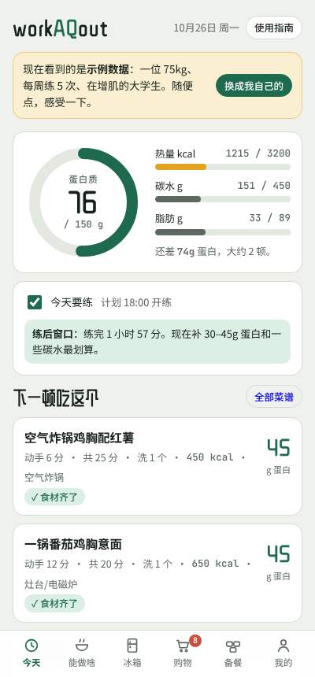
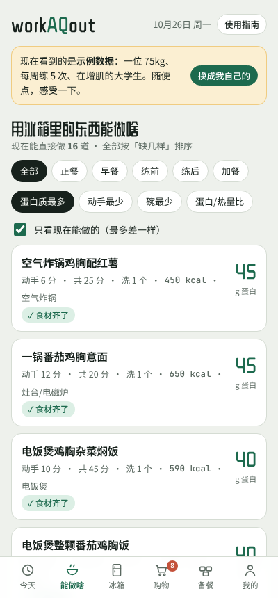
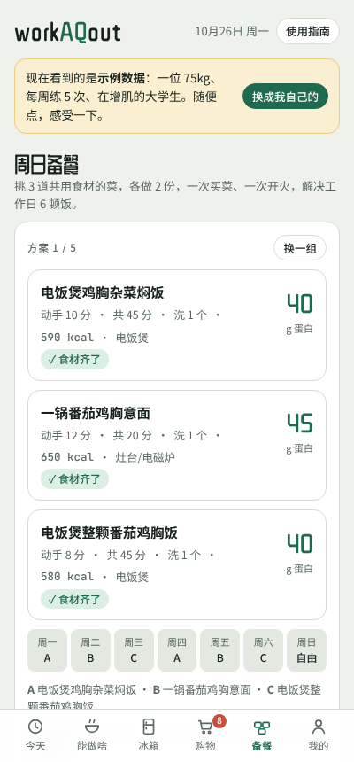

# workAQout（练后吃啥）

**👉 立即试用：https://aqjc19.github.io/AQ_stuff/fuel/** （手机打开后「添加到主屏幕」就像 App 一样）

给**爱健身、但不太会做饭、也没什么时间**的学生用的厨房助手。

它解决三个问题：

1. **今天该吃多少？** 按你的身高、体重、目标和训练频率，算出每天要吃的热量和蛋白质。
2. **冰箱里这些东西能做啥？** 只推荐你现在食材够、厨具能做的高蛋白快手菜，按「动手几分钟」「洗几个碗」排序。
3. **什么快吃完了？** 记住你多久买一次鸡蛋、鸡胸，在你吃完之前就把它放进购物清单。

| 今天 | 能做啥 | 周日备餐 |
| --- | --- | --- |
|  |  |  |

## 和现有 App 有什么不一样

| | 一般的菜谱 App | 一般的记账/购物清单 App | workAQout |
| --- | --- | --- | --- |
| 按冰箱现有食材推荐 | 部分 | ✗ | ✓ 还会告诉你「只差一样」 |
| 按训练时间推荐练前/练后餐 | ✗ | ✗ | ✓ |
| 学习你的购买频率、预测快没了 | ✗ | ✗ | ✓ |
| 按厨具过滤（只有微波炉也能用） | 很少 | ✗ | ✓ |
| 过敏 / 不吃的食材 / 不喜欢的口味 一起过滤 | 很少 | ✗ | ✓ 过敏连调料也排除 |
| 每道菜一键跳到小红书 / B站 / 下厨房 看视频 | ✗ | ✗ | ✓ |
| 显示动手时间和要洗几个碗 | ✗ | ✗ | ✓ |
| 需要注册、联网 | 通常需要 | 通常需要 | 不需要 |

## 怎么运行

不需要安装任何东西。

- **手机 / 电脑**：直接打开 https://aqjc19.github.io/AQ_stuff/fuel/
- **离线用**：下载这个文件夹，双击 `index.html`，用 Chrome / Safari / Edge 打开就行。

### 添加到手机主屏幕

加好之后桌面上会有一个 workAQout 图标（哑铃 + 饭碗），点开是全屏的，没有浏览器地址栏，用起来和 App 一样。

**iPhone（必须用 Safari）**
1. 用 Safari 打开上面的网址（在微信里打开的话，点右上角「···」→「在默认浏览器中打开」）。
2. 点底部中间的**分享**按钮（方框 + 向上箭头）。
3. 往下滑，点「**添加到主屏幕**」→ 右上角「**添加**」。

**安卓（Chrome）**
1. 用 Chrome 打开网址。
2. 点右上角 **⋮** →「**添加到主屏幕**」或「**安装应用**」→「添加」。

**电脑（Chrome / Edge）**：地址栏右边会出现一个「安装」图标，点它就会变成一个独立窗口的 App。

> 之前已经加过旧图标的：先在桌面上长按删除旧的，再按上面的步骤重新添加一次，就会换成新图标。
- **用 GitHub Pages 发布**：在仓库的 Settings → Pages 里，Source 选 `main` 分支、根目录，保存。几分钟后就能通过
  `https://aqjc19.github.io/AQ_stuff/fuel/` 访问。注意仓库需要是 Public（或者你有 GitHub Pro）。

所有数据只保存在你自己浏览器的 localStorage 里，不会上传到任何服务器。

## 使用指南

App 右上角的「使用指南」按钮里也有这一份。

### 第一次使用（约 3 分钟）

1. **打开后看到的是示例数据**：一位 75kg、每周练 5 次、在增肌的大学生。可以随便点，感受一下。
2. 点顶部的 **「换成我自己的」**，进入「我的」页面。
3. **填身体档案**：性别、年龄、身高（cm）、体重（kg）、目标（减脂 / 维持 / 增肌）、每周训练几次、一般几点练、家里有哪些厨具、饮食习惯（什么都吃 / 素食）、过敏、不喜欢的口味、不吃的食材（见下面「忌口」）。
   点「算出我的目标」，会显示你每天的热量、蛋白质、碳水、脂肪目标，以及是怎么算出来的。
4. 自动跳到 **「冰箱」**：点下面「+ 鸡蛋」「+ 生鸡胸肉」这样的按钮，把家里现有的东西加进去。

### 每天怎么用

- **「今天」页**
  - 圆环是今天已经吃了多少蛋白质；右边是热量、碳水、脂肪。
  - 打开 **「今天要练」**：训练前 3 小时内会推荐好消化的练前餐；练完 2 小时内会推荐高蛋白练后餐。
  - **「下一顿吃这个」**：根据你还差多少蛋白、冰箱里有什么、现在是不是练前/练后，挑两道最合适的菜。
  - 吃了东西就点 **「+ 蛋白粉一勺」** 这类快捷按钮，或者在菜谱里点 **「吃了这个」**。记错了点 × 删除。
- **「能做啥」页**
  - 列出所有菜谱，食材齐的排最前面，差一样的会写「差 西兰花」。
  - 可以按餐别（正餐 / 早餐 / 练前 / 练后 / 加餐）筛选，按「蛋白质最多」「动手最少」「碗最少」「蛋白/热量比」排序。
  - 点开一道菜：看营养、食材（✓ 有 / ✗ 缺）、步骤。缺的食材可以一键加进购物清单。
  - **看视频教程**：菜谱详情底部有「小红书 ↗」「B站 ↗」「下厨房 ↗」三个按钮，会在新窗口搜索这道菜的做法。第一次做的菜建议先看一个视频。
- **「冰箱」页**
  - 每样东西有一个条，表示离你「通常吃完的时间」还有多远。
  - 买了就点 **「买了」**，吃光了就点 **「吃完了」**。

### 忌口

在「我的」页面设置，保存后所有页面立刻生效：

| 设置 | 效果 |
| --- | --- |
| **饮食习惯：素食（吃蛋奶）** | 去掉所有含肉、鱼、虾的菜 |
| **过敏**：鸡蛋、海鲜/鱼、花生、大豆、小麦/麸质、乳制品 | **严格排除**：主料和调料都算。比如大豆或麸质过敏会排除所有用酱油的菜（酱油含大豆和小麦），乳制品过敏也会排除蛋白粉 |
| **不喜欢的口味**：辣、酸、甜 | 去掉偏辣（泡菜）、偏酸（番茄类）、偏甜（香蕉、花生酱类）的菜 |
| **不吃的食材**：任选，按类别分组 | 主料里有它的菜会被隐藏；如果只是调料（比如蒜），菜照样推荐，详情页会提示「按你的忌口不放：蒜」 |

被排除的食材也不会再出现在「冰箱」和「购物」的添加按钮里。「能做啥」页顶部会显示有几道菜因为厨具或忌口被隐藏。

> 过敏过滤只基于这个 App 自带菜谱写明的食材。买现成食品（卷饼皮、即食鸡胸、蛋白粉等）时，请一定看包装上的过敏原说明。

### 去超市前

- **「购物」页** 会自动列出：已经吃完的、按你的习惯快吃完的、做菜缺的。底部还可以手动加。
- 在超市里买一样勾一样，结账后点 **「勾选的都买好了」**，冰箱会自动更新，同时记下这次购买的日期。
- 「复制清单」可以把清单发给室友。

### 周日备餐

- **「备餐」页** 会从你能做的菜里挑 3 道**共用食材**的（A、B、C），各做 2 份，正好管周一到周六的 6 顿正餐。
- 它会告诉你这 6 顿一共多少蛋白、占一周目标的百分比，以及还要买哪些东西（一键加进购物清单）。
- 不喜欢这一组就点 **「换一组」**。

## 它是怎么算的

**每日目标**

- 基础代谢 BMR 用 Mifflin-St Jeor 公式：
  男 `10×体重kg + 6.25×身高cm − 5×年龄 + 5`，女 `… − 161`。
- 每日消耗 TDEE = BMR × 活动系数。系数按每周训练次数从 1.3（0 次）到 1.8（7 次）。
- 目标热量：减脂 −20%（不低于 BMR），维持 ±0，增肌 +10%。
- 蛋白质：减脂 2.2 g/kg，维持 1.8 g/kg，增肌 2.0 g/kg。脂肪占热量 25%，剩下的给碳水。

**「快没了」预测**

- 每次点「买了」，记下日期。买过 2 次以上，就用**你两次购买之间的平均天数**作为这样东西的消耗周期；不到 2 次时先用默认值（比如鸡蛋 7 天、牛奶 5 天）。
- 距离上次购买的天数 ≥ 周期的 85%，就标成「快没了」并放进购物清单。

**周日备餐组合**

- 在你厨具和忌口允许、每份蛋白 ≥ 25g 的正餐里，枚举所有 3 道菜的组合，打分：
  总蛋白 + 共用食材数 × 14 − 食材种类数 × 6 − 要买的数量 × 5 + 适合备餐的菜 × 8 − 动手时间 × 0.4。
  取分数最高的几组。

> 菜谱的营养数据是按常见分量估算的，适合日常参考，不能代替营养师的建议。

## 文件

```
fuel/
├── index.html             整个 App（HTML + CSS + JS 一个文件，无依赖）
├── manifest.webmanifest   App 名字、图标、全屏模式（添加到主屏幕用）
├── icons/                 App 图标（icon.svg 是源文件）
└── README.md              这份说明
```

想加自己的菜：在 `index.html` 里找到 `const R = [`，照着格式加一行即可（`need` 写主要食材的 id，`g` 写需要的厨具）。
